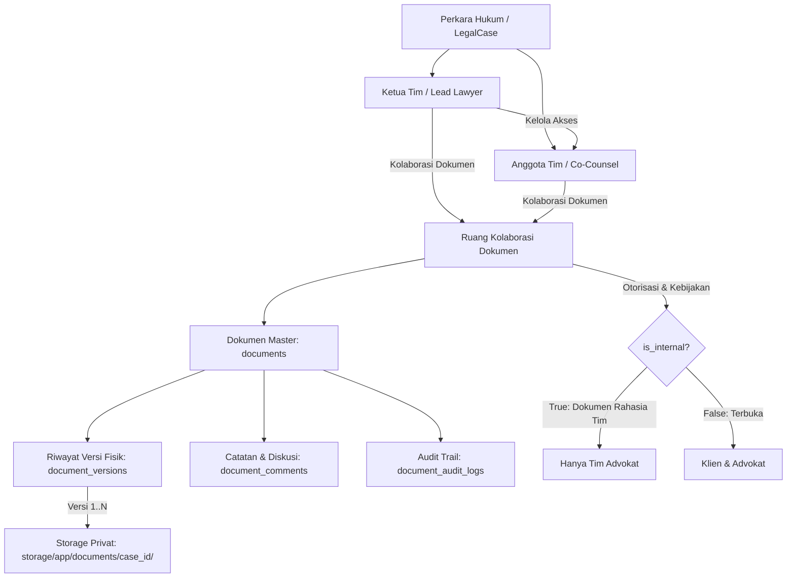

# Panduan Penggunaan & Walkthrough: Fitur Kolaborasi Dokumen Advokat (Sahabat Hukum)

Dokumen ini memuat panduan lengkap implementasi dan alur kerja **Fitur Kolaborasi Dokumen Perkara Berbasis File dan Versioning** pada sistem **Sahabat Hukum**.

---

## 1. Arsitektur & Konsep Dasar

Fitur ini memungkinkan beberapa Advokat yang berwenang pada perkara yang sama untuk berkolaborasi menyusun berkas hukum (Surat Kuasa, Surat Gugatan, Jawaban, Replik, Duplik, Alat Bukti, dan Kajian Hukum) dalam satu ruang kerja terpadu.



### Prinsip Utama:
1. **Non-Destructive File Versioning**: Unggahan revisi tidak pernah menimpa file fisik sebelumnya. Setiap versi disimpan dengan UUID unik di storage privat, sehingga versi lama (`v1`, `v2`, dst.) dapat diunduh kembali kapan saja.
2. **Kompak & Kompatibel**: Tidak merombak struktur lama. Dokumen bukti lama dari klien tetap berjalan dengan alur verifikasi semula.
3. **Pemisahan Kerahasiaan Klien**: Dokumen internal tim advokat diberi tanda `is_internal = true` dan secara mutlak diisolasi di level database dan policy server agar tidak dapat diakses atau diintip oleh Klien.

---

## 2. Struktur Berkas yang Terlibat

| Komponen | Berkas | Peran / Tanggung Jawab |
| :--- | :--- | :--- |
| **Model** | [CaseLawyer.php](file:///c:/laragon/www/SahabatHukum/app/Models/CaseLawyer.php) | Relasi anggota tim advokat penanganan perkara |
| **Model** | [DocumentVersion.php](file:///c:/laragon/www/SahabatHukum/app/Models/DocumentVersion.php) | Menyimpan snapshot file fisik versi dokumen |
| **Model** | [DocumentComment.php](file:///c:/laragon/www/SahabatHukum/app/Models/DocumentComment.php) | Catatan revisi & komentar terhubung versi |
| **Model** | [LegalCase.php](file:///c:/laragon/www/SahabatHukum/app/Models/LegalCase.php) | Relasi tim perkara & helper otorisasi |
| **Model** | [Document.php](file:///c:/laragon/www/SahabatHukum/app/Models/Document.php) | Master pointer dokumen, flag `is_internal`, status kolaborasi |
| **Controller** | [AdvokatController.php](file:///c:/laragon/www/SahabatHukum/app/Http/Controllers/AdvokatController.php) | Handler ruang kolaborasi, upload versi, komentar, finalisasi, kelola tim |
| **Controller** | [DocumentController.php](file:///c:/laragon/www/SahabatHukum/app/Http/Controllers/DocumentController.php) | Handler unduhan berkas fisik versi spesifik (`downloadVersion`) |
| **Controller** | [ClientController.php](file:///c:/laragon/www/SahabatHukum/app/Http/Controllers/ClientController.php) | Isolasi dokumen: memfilter keluar dokumen `is_internal` |
| **Policy** | [DocumentPolicy.php](file:///c:/laragon/www/SahabatHukum/app/Policies/DocumentPolicy.php) | Otorisasi server-side: pemblokiran 403 untuk Klien dan advokat luar tim |
| **Notification**| [DocumentCollaborationNotification.php](file:///c:/laragon/www/SahabatHukum/app/Notifications/DocumentCollaborationNotification.php) | Notifikasi database bagi rekan tim perkara |
| **View Blade** | [collaboration.blade.php](file:///c:/laragon/www/SahabatHukum/resources/views/advokat/collaboration.blade.php) | Antarmuka utama ruang kolaborasi dokumen advokat |
| **View Blade** | [cases.blade.php](file:///c:/laragon/www/SahabatHukum/resources/views/advokat/cases.blade.php) | Tombol akses cepat & kartu ringkasan tim advokat |
| **Tests** | [DocumentCollaborationTest.php](file:///c:/laragon/www/SahabatHukum/tests/Feature/DocumentCollaborationTest.php) | Uji fitur otomatis mencakup seluruh skenario fungsional |

---

## 3. Langkah demi Langkah Alur Penggunaan (Walkthrough)

### Langkah 1: Membuka Ruang Kolaborasi Perkara
1. Masuk ke akun **Advokat** (misal: `advokat@sahabathukum.test`).
2. Masuk ke menu **Perkara** di sidebar (`/advokat/perkara`).
3. Pilih salah satu perkara yang sedang aktif.
4. Pada panel atas atau kartu ringkasan perkara di sebelah kanan, klik tombol **"Kolaborasi Dokumen"** atau **"Masuk Ruang Kolaborasi"**.
5. Sistem akan menampilkan halaman **Ruang Kolaborasi Dokumen** dengan metrik dokumen, daftar tim advokat, toolbar filter, dan tabel berkas perkara.

> [!NOTE]
> Jika advokat yang mencoba mengakses bukan ketua tim perkara atau anggota tim yang ditugaskan, sistem akan menolak akses dengan respons HTTP `403 Forbidden`.

---

### Langkah 2: Mengelola Tim Advokat (Khusus Ketua Tim / Lead Lawyer)
1. Pada kartu **Tim Advokat Perkara**, Ketua Tim dapat melihat rekan yang telah ditugaskan.
2. Klik tombol **"+ Tambah"**.
3. Pilih rekan advokat dari daftar dropdown dan tentukan perannya (misal: *Anggota Tim / Co-Counsel*, *Advokat Pendamping*, atau *Penyusun Dokumen Hukum*).
4. Klik **Tugaskan ke Perkara**.
5. Advokat yang baru ditugaskan otomatis memperoleh hak akses penuh ke perkara dan menerima notifikasi penugasan.
6. Untuk mencabut akses advokat pendamping, Ketua Tim dapat menekan ikon tempat sampah/user-x pada daftar anggota.

---

### Langkah 3: Mengunggah Dokumen Kerja Baru (v1)
1. Klik tombol **"+ Unggah Dokumen Baru"** pada pojok kanan atas halaman.
2. Isi formulir:
   - **Nama Dokumen**: Contoh `"Surat Gugatan Perdata Wanprestasi"`.
   - **Jenis Dokumen**: Pilih dari opsi (*Surat Kuasa, Surat Gugatan, Jawaban, Replik, Duplik, Alat Bukti, Kajian Hukum, Dokumen Lainnya*).
   - **Tingkat Kerahasiaan / Akses**:
     - `🔒 Internal Tim Advokat`: Dokumen draf kerja tertutup (Klien **tidak** dapat melihat).
     - `👥 Terbuka / Dapat Dilihat Klien`: Dokumen resmi yang sudah siap dibagikan ke Klien.
   - **Berkas File**: Pilih file (PDF, DOC, DOCX, JPG, PNG, XLS maks. 10 MB).
   - **Catatan Revisi Awal**: Keterangan draf awal posita dan petitum.
3. Klik **Unggah Dokumen**.
4. Dokumen tercatat sebagai **Draf v1**, dan anggota tim lain menerima notifikasi dokumen baru.

---

### Langkah 4: Siklus Revisi & Pengunggahan Versi Baru (v2, v3, dst.)
1. Pada tabel dokumen, cari dokumen yang ingin diperbaiki, lalu klik ikon **Unggah Revisi** (ikon awan biru).
2. Sistem menampilkan modal dengan informasi nomor versi berikutnya secara otomatis (misal `Versi v2`).
3. Pilih file revisi baru dan tentukan statusnya (*Dalam Revisi* atau *Menunggu Persetujuan*).
4. **Wajib** menuliskan catatan perubahan pada kolom **Catatan Perubahan / Revisi** (misal: *"Menyesuaikan petitum ganti rugi bunga moratoir 6%"*).
5. Klik **Unggah Versi Baru**.
6. Sistem menyimpan file versi baru secara terpisah tanpa menghapus file `v1`.

---

### Langkah 5: Diskusi Tim & Catatan Revisi per Versi
1. Klik ikon **Komentar & Riwayat** (ikon pesan) pada baris dokumen terkait.
2. Modal akan menampilkan 2 tab:
   - **Tab Riwayat Versi**: Menampilkan daftar timeline seluruh versi (`v1`, `v2`, `v3`), tanggal unggah, pengunggah, catatan revisi, dan tombol **Unduh** berkas fisik untuk masing-masing versi.
   - **Tab Catatan & Komentar**: Menampilkan riwayat percakapan/saran perbaikan dari tim advokat.
3. Advokat dapat mengetikkan saran revisi, memilih versi yang sedang dibahas pada dropdown, lalu menekan tombol **Kirim**.

---

### Langkah 6: Penetapan Dokumen sebagai Versi Final
1. Setelah seluruh anggota tim sepakat dan draf telah disetujui, advokat menekan ikon **Centang Hijau** (Tetapkan Versi Final).
2. Konfirmasi dialog akan muncul. Klik **Tetapkan Final Sekarang**.
3. Status dokumen berubah menjadi **Final** (badge hijau dengan tanda centang).
4. Sistem mencatat versi aktif sebagai `is_final = true`, serta menyimpan waktu dan identitas advokat yang memfinalisasi.

> [!TIP]
> **Revisi Setelah Final:** Jika sewaktu-waktu pengadilan atau pihak prinsipal meminta revisi lanjutan pada dokumen yang sudah final, advokat tetap dapat mengunggah revisi baru. Sistem akan menerbitkan versi berikutnya (misal `v3`), sementara versi final lama (`v2`) tetap tersimpan utuh dan terdata sebagai arsip final sebelumnya.

---

## 4. Pengamanan & Isolasi Hak Akses Klien

Pemisahan akses dokumen diatur secara berlapis:

```
[Permintaan Berkas dari Pengguna]
              │
              ▼
   ┌──────────────────────┐
   │ DocumentPolicy@view  │
   └──────────┬───────────┘
              │
       User Role Klien?
              ├─────────────► Dokumen is_internal == true?
              │                     ├─► [YA]  ==> HTTP 403 FORBIDDEN (Ditolak)
              │                     └─► [TIDAK] ==> Diizinkan jika pemilik perkara
              │
       User Role Advokat?
              ├─────────────► Terdaftar di cases.lawyer_id ATAU case_lawyers?
              │                     ├─► [YA]  ==> Diizinkan
              │                     └─► [TIDAK] ==> HTTP 403 FORBIDDEN (Ditolak)
              ▼
       User Role Admin? ===> Diizinkan (Supervisi)
```

1. **Proteksi IDOR**: Endpoint `/documents/{id}/view`, `/documents/{id}/download`, dan `/documents/{id}/versions/{versionId}/download` semuanya memeriksa authorization gate.
2. **Pembersihan Tampilan Klien**: Pada [ClientController.php](file:///c:/laragon/www/SahabatHukum/app/Http/Controllers/ClientController.php#L274) dan [ClientController.php](file:///c:/laragon/www/SahabatHukum/app/Http/Controllers/ClientController.php#L314), query dokumen menyertakan klausa `where('is_internal', false)`.
3. **Validasi Berkas**: File executable, skrip berbahaya, dan berkas di atas 10 MB langsung ditolak oleh validasi controller.

---

## 5. Ringkasan Pengujian Otomatis

Seluruh skenario telah divalidasi menggunakan automated test [DocumentCollaborationTest.php](file:///c:/laragon/www/SahabatHukum/tests/Feature/DocumentCollaborationTest.php):

| Skenario Pengujian | Hasil |
| :--- | :---: |
| Otorisasi akses ketua tim, penugasan advokat pendamping, & blokir advokat luar | **PASS** |
| Siklus versioning (v1 $\rightarrow$ v2) tanpa menimpa berkas lama | **PASS** |
| Unduhan berkas spesifik untuk tiap nomor versi | **PASS** |
| Sistem komentar terhubung dengan pembuat dan versi dokumen | **PASS** |
| Finalisasi versi & kemampuan revisi setelah final | **PASS** |
| Isolasi ketat: Klien diblokir 403 dan tidak melihat dokumen internal | **PASS** |
| Penolakan berkas berbahaya (ekstensi `.exe`, dll.) | **PASS** |
| Uji regresi fitur lama: upload berkas klien & verifikasi dokumen | **PASS** |
| Uji regresi notifikasi, perkara, dan konsultasi | **PASS** |
